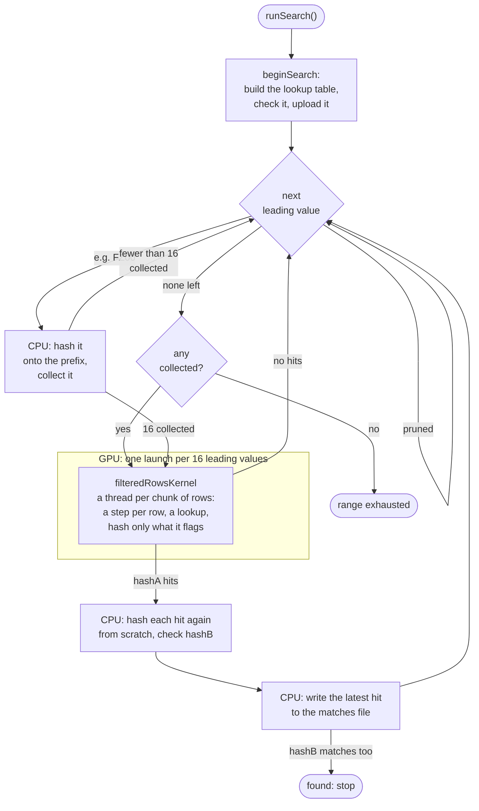

# How a search works

## A search, end to end

Every filename a search tries is split into parts that different pieces of
the program deal with. Here, `REZ\FZ00ODMEA.WAV` - a 9-character
candidate between the prefix `REZ\` and the suffix `.WAV`, with the default
window of 5 trailing characters:

```text
  R E Z \ F Z 0 0 O D M E A . W A V
  └──┬──┘ └──┬──┘ └─┬─┘ │ │ └──┬──┘
     │       │      │   │ │    └───── suffix: fixed
     │       │      │   │ └────────── the candidate's last character  ┐
     │       │      │   └──────────── the row's last character        ├ trailing: the GPU
     │       │      └──────────────── the row group's characters      ┘
     │       └─────────────────────── leading: the CPU, one value at a time
     └─────────────────────────────── prefix: fixed
```

The CPU walks through every value of the leading characters (see the next
section), and for each one the GPU searches every combination of the
trailing ones: in *rows* (every trailing character but the last fixed),
which come in *row groups*, of which each GPU thread takes a *chunk* (see
[How the GPU kernel is structured](#how-the-gpu-kernel-is-structured)). A lookup table
then tells it which of a row's candidates could match at all, so that only
those are hashed in full (see [The lookup
filter](lookup-filter.md)). With the real
49-character alphabet, one leading value is 49^5 = 282,475,249 candidates:
5,764,801 rows of 49, in 117,649 row groups of 49 rows - one row group per
GPU thread. The CPU collects 16 leading values that
aren't pruned (`NAMEBREAK_BATCHES_PER_LAUNCH`), and one kernel launch
searches them all, a row of thread blocks for each.



## The GPU doesn't brute-force the whole candidate

Only a small, fixed-size trailing window of each candidate
(`NAMEBREAK_GPU_WINDOW_CHARS` characters, currently 5, set in
`src/backends/cuda/tuning.h`) is enumerated directly on the GPU. Anything beyond that is treated as an extension of the prefix: every
combination of those leading characters is enumerated on the CPU and its
hash contribution folded in once (incrementally - O(1) amortized per step,
not a full rehash) before the GPU launches for that leading value. The
window is bounded above (`kMaxTrailingLen`, 6, in the same file) because the
kernel indexes rows with 32-bit integers.

The window is a launch-size knob more than a per-thread-cost knob (see
below), and 5 measured best on the reference hardware with the kernel as it
was before [the lookup filter](lookup-filter.md)
(about 155 G candidates/s at a window of 4, 222 at 5, 216 at 6): a window
of 4 makes each leading value's launch so short (~25 us) that per-launch
overhead becomes a large fraction of the runtime. The lookup filter and the
row chunks made every launch about seven times shorter: a leading value took
0.13 ms, and the GPU idled about 10 us between two launches, 9.7% of the
time. A window of 6 would win that back, but leave the CPU a character
fewer to prune on - a wash, measured (see [PERFORMANCE.md](../PERFORMANCE.md)).
So the window stayed at 5, and a launch searches 16 leading values instead
(see below): the GPU now idles 1.6% of the time, and the search got about
7% faster. Note the window
also decides how much `prune_symbol_runs`/`prune_unopened_brackets`/`max_backslash_count`
can see, unless `prune_whole_candidate` is on (they otherwise only examine the leading
characters, see below): a larger window means fewer
characters are pruned on, so those settings skip slightly fewer
candidates than they did at a window of 4 (never more).

## How the GPU kernel is structured

Hashing a candidate means feeding its characters through the hash function
one at a time, each step depending on the one before it. That means two
candidates sharing the same first few characters redo the exact same first
few steps, if hashed independently - wasted, repeated work.

The kernel avoids that by working on **rows** instead of individual
candidates. A row is one fixed value for every trailing character *except
the last* - e.g. with a 3-character trailing window and alphabet `A..Z`,
the row `XY*` covers the 26 candidates `XYA`, `XYB`, `XYC`, ... `XYZ`. One
GPU thread owns one whole row: it hashes the shared part (`XY`) exactly
once, then loops just the last character over the alphabet, reusing that
one result for every candidate in the row. So each of those 26 candidates
costs only one more character step plus the suffix, instead of every one
of them separately re-hashing the whole trailing window from scratch.

The engine hands the backend the trailing space in *batches*: each covers
at most `NAMEBREAK_ROWS_PER_LAUNCH` rows (8,388,608 by default, set in
`src/backends/cuda/tuning.h`) of one leading value, and always a whole
number of them - a batch's boundaries land on row boundaries, except
possibly at the very start or end of the range being searched. With the
5-character window a batch is a whole leading value (5,764,801 rows). One
kernel launch searches up to `NAMEBREAK_BATCHES_PER_LAUNCH` batches (16, in
the same file), each with its own rows and seeds, on its own row of thread
blocks (`blockIdx.y`) - consecutive batches, of one leading value or several,
with any pruned ones between them left out. The OpenCL kernel does the same
(a row of work-groups per batch); the Metal one still searches one batch per
launch. That bounds how long any single launch can run for (a couple of
milliseconds), since pause and abort are only checked *between* launches,
not in the middle of one. The host sleeps through most of each launch rather
than spinning a CPU core while it waits (`backends/common/launch_waiter.h`):
about a fifth of a core instead of a whole one, at the same speed.

So only a batch's first and last row can be cut short. With the
3-character window and `A..Z` from above, a batch from `XDJ` to `YKT`:

```text
                 A B C D E F G H I J K L M N O P Q R S T U V W X Y Z
 first row  XD*  . . . . . . . . . x x x x x x x x x x x x x x x x x  <- firstRowStartK = 9 (J)
            XE*  x x x x x x x x x x x x x x x x x x x x x x x x x x
            ...  every row in between: all of it
 last row   YK*  x x x x x x x x x x x x x x x x x x x x . . . . . .  <- lastRowEndK = 20 (to T)
```

The CUDA kernel takes this one step further. Consecutive rows share even
more than their candidates do: the rows `XA*`, `XB*`, ... `XZ*` all start
with `X`. So a *row group* - the rows that share every trailing character
but the row's own last - is split into chunks of about
`NAMEBREAK_ROWS_PER_THREAD` consecutive rows (64, in `tuning.h`: more than
any alphabet has characters, so a whole group per thread), and one thread
takes a chunk: it
hashes the group's shared characters once, and each of its rows then costs
one more step, instead of every thread working out its row's characters
from its number (a division per character) and hashing all of them. A chunk
never crosses into another group, and the kernel walks all the chunks of a
launch itself, so how many threads are launched only decides how the work
is shared out, never what gets searched. That made the search about a third
faster again (1,088-1,124 to 1,434-1,467 G candidates/s, three runs each
side by side; 1 row per thread measured 1,133, 7 rows 1,575, 25 rows 1,659
and 49 rows 1,611 in a cooler run - 25 was the default then; a whole group
is now 2-6% faster than 25, see below). The OpenCL kernel does the same, but
does best with a whole row group per work-item (1 row per work-item measured
about 880, 7 about 1,300, 25 about 1,435, and 49 and 64 about 1,460). The
Metal kernel does the same, with CUDA's 25 rows per thread until it has
been measured on a Mac (see [PERFORMANCE.md](../PERFORMANCE.md)).

Group `X**` from above, with its 26 rows split into two chunks of 13 (as
with 13 rows per thread), marked with what the lookup filter
described below does to each candidate - `#`: flagged, hashed in full; `·`:
never hashed. (Where the `#`s fall here is made up; a row has
alphabetSize / 256 of them on average.)

```text
                     last character
                     A B C D E F G H I J K L M N O P Q R S T U V W X Y Z
              ┌ XA*  · · · · · · # · · · · · · · · · · · · · · · · · · ·
              │ XB*  · · · · · · · · · · · · · · · · · · · · · · · · · ·
 thread 1:    │ ...
 chunk 0      │ XL*  · · · · · · · · · · · · · · · · · · · · · · · · · ·
              └ XM*  · · · · · · · · · · · · · · · · · · · # · · · · · ·
              ┌ XN*  · · · · · · · · · · · · · · · · · · · · · · · · · ·
 thread 2:    │ ...
 chunk 1      │ XY*  · · · · · · · · · · · · · · · · · · · · · · · · · ·
              └ XZ*  · # · · · · · · · · · · · · · · · · · · · · · # · ·
```

Thread 1 hashes `X` once, then one more character for each of `XA*` to
`XM*`; thread 2 does the same for `XN*` to `XZ*`. Every row then costs one
table lookup, and only its `#`s are hashed any further.

The CUDA kernel hashes a chunk's `#`s only after it has looked up all of its
rows: the row walk just notes which rows have any (a bit per row), and a
second loop then hashes them, one candidate per lane per round. The 32 lanes
of a warp go round a loop together as often as the busiest of them needs,
so hashing each row's `#`s right after its lookup cost as many rounds as
the busiest lane's `#`s in *every row* - about two a row, though a row has
less than one on average - and each round hashes the whole suffix. Now it
costs as many as the busiest lane's `#`s in the whole chunk. On its own that
made the CUDA kernel about 17% faster with an 11-character suffix, and no
faster with `.WAV` - but it is why longer chunks (a whole group) and a
smaller table (6 bits, see below) now pay off there: all together, 14-22%
faster with `.WAV` and about 35% with an 11-character suffix.

What a thread then does with its rows: the GPU kernels
(`filteredRowsKernel`, `search.cl`, `search.metal`) look each row up in a
table and hash only the handful of its candidates that could possibly
match, as [The lookup filter](lookup-filter.md)
below explains. Before they had the filter, they hashed every candidate of the row,
as the CPU backend still does, which two more things made fast:

- **The loop over the last character is fully unrolled**, with its
  alphabet position known at compile time for every iteration. That lets
  the compiler bake each character's hash-table value directly into the
  generated instructions, instead of looking it up from memory at runtime.
  This matters because GPU threads execute in lockstep, 32 at a time (a
  "warp") - a runtime lookup where each of those 32 threads needs a
  different table entry serializes the whole warp, one lookup at a time,
  while a compile-time constant costs nothing extra.
- **The suffix length is a compile-time parameter too** (for lengths 0-12;
  longer suffixes fall back to a slower runtime-length loop), for the same
  reason. The CUDA kernel still does this for the candidates it does hash.

Together, the row-based design measured about 16x faster than the
previous one-thread-per-candidate kernel, while still producing
bit-for-bit identical hashes.

The search kernel only *records where* each hashA hit is - its trailing
index and batch - and doesn't build the filename or check hashB, keeping
its hot path as small as possible. The count of hits and the first 16 of
them come back with the one small copy that follows every launch, and the
CPU checks each one (`HitVerifier`, shared by every backend but
`reference`): it rebuilds the complete filename from the trailing index and
hashes it from scratch - independent code, on a different processor, not
the row-based fast path - and checks hashB. So every hit gets cross-checked
by a second implementation at runtime, and a launch with a hit costs the
GPU no more idle time than one without. Any disagreement between the two
prints a `WARNING`, which the test suite treats as a failure. (The CUDA
backend used to do this in a second kernel, launched after every launch
with a hit; with 16 leading values per launch, two launches in three have
one, and that kernel and its copies left the GPU idle about 35 us each
time.)

Only the first `MAX_MATCHES` (1024) hits from one launch can be recorded
at all. If a launch somehow has more than that, each of its batches is
searched again on its own, and a batch with too many is searched again as
two halves (recursively, if needed), so every hit still gets checked against
hashB rather than silently lost. With a real 32-bit hash
this essentially never happens in practice (it would take over a thousand
collisions in a single launch), but it's handled explicitly and tested
(`tests/search_overflow_test.cpp`).
