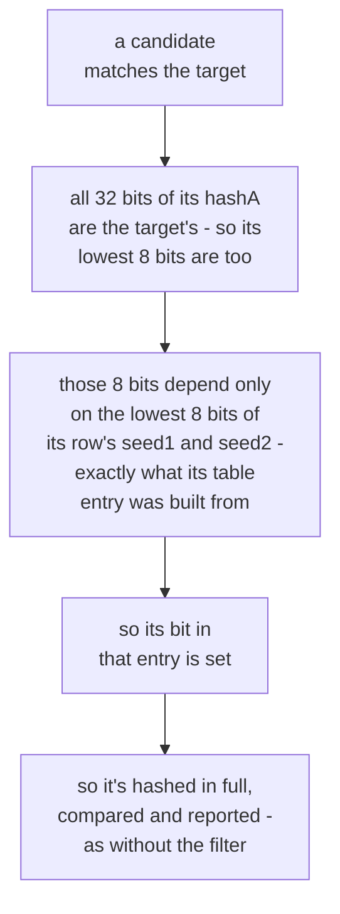
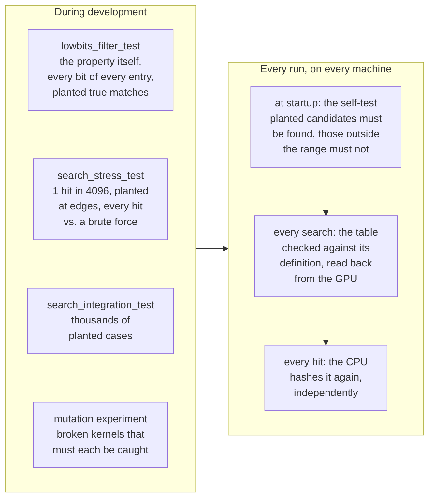

# The lookup filter: most candidates are never hashed

The backends - CUDA (and HIP), OpenCL, Metal and the CPU one - don't hash
every candidate of a row; only `reference` does. In the real search (a 49-character alphabet and `.WAV`) they hash about one in
128 - on average 0.38 of a row's 49 candidates - because they can tell from
a single table lookup that the rest can't match. That made the whole search
5.2 times as fast with CUDA (`search_bench --scale 20` on the RTX 3080 Ti
Laptop, three runs each: from 209-218 to 1,084-1,130 G candidates/s) and
5.3 times with OpenCL (from 202-205 to 1,082-1,086), without skipping
anything a full search would find.

## Why it works

Every step of the MPQ hash is

```
seed1 = key[ch] ^ (seed1 + seed2)
seed2 = ch + seed1 + seed2 + (seed2 << 5) + 3
```

It's only additions, an XOR, a left shift and constants; the crypt table is
indexed by the character, never by the hash state. In each of those, bit
*i* of the result depends only on bits 0..*i* of what goes in: an
addition's carries only travel upward, an XOR works bit by bit, and a left
shift only moves bits upward. So the same holds for any number of steps:
**the lowest *n* bits of hashA depend only on the lowest *n* bits of the
state it's computed from** (and on the characters).

For example, the row `REZ\FZ00ODME*` of the real search, and its candidate
with the last character `A`. Whatever the 24 high bits of its state are,
the steps for `A` and then `.WAV` end with the same 8 lowest bits:

```text
   bit                31                     8   7      0
                    ┌──────────────────────────┬──────────┐
   seed1            │ ???????????????????????? │ 00100010 │  0x22
   seed2            │ ???????????????????????? │ 10110011 │  0xB3
                    └──────────────────────────┴──────────┘
   + A, then .WAV:
     seed1 + seed2   a carry only ever moves one bit left, to the next bit up
     key ^ ...       every bit on its own
     seed2 << 5      every bit moves 5 places left
                    ┌──────────────────────────┬──────────┐
   hashA            │ ???????????????????????? │ 10010000 │  0x90, whatever the ?s were
                    └──────────────────────────┴──────────┘
                      the ?s can never reach these 8 bits: bits only move <-- this way
```

All of a row's candidates continue from the same state (seed1, seed2) - the
one after the row's shared characters - with one last character, then the
suffix. So which of them have a hashA whose lowest 8 bits are the target's
depends only on the lowest 8 bits of seed1 and of seed2: 65,536
possibilities. Before a search, the backend works out, for each of them,
which last characters give the target's lowest 8 bits, as a 64-bit mask
with one bit per alphabet character - a 512 KB table
(`buildLowBitsFilterTable`, `src/backends/common/lowbits_filter.h`). Each
thread looks its row up in it and hashes only the candidates in the mask,
in full, exactly as before.

The examples here use 8 bits, but the OpenCL, Metal and CPU backends ship
with 7 (`NAMEBREAK_LOWBITS_FILTER_BITS`): a 128 KB table, which lets twice
as many candidates through, is still faster, because it stays in the GPU's
caches. Measured on the RTX 3080 Ti Laptop (`search_bench --scale 20`,
interleaved runs): 6 bits about 1,770 G candidates/s, 7 about 1,800, 8
about 1,550, 9 about 1,580, and 10 (an 8 MB table, twice the L2 cache)
about 390. The CUDA backend has used 6 (`kCudaLowBitsFilterBits`, a 32 KB
table) since it started hashing a chunk's flagged candidates after all of
its rows: each one it lets through costs less, so the smaller table's
cheaper reads win - about 13% faster than 7 bits with `.WAV`, and the same
with an 11-character suffix. The OpenCL and CPU backends measured 3-17%
slower at 6 bits, and keep 7.

The same row, looked up for the real target (every number here is computed,
not made up):

```text
  row REZ\FZ00ODME* of the real search, target hashA 0xF60F5D90

  the state after REZ\FZ00ODME        seed1 = 0xA2E45422      seed2 = 0xCC16ABB3
                                                      ──                      ──
  their lowest 8 bits                               0x22                    0xB3
                                                       └───────────┬───────────┘
  the table entry (seed2's 8 bits, then seed1's)                 0xB322
                                                                   │
                                                                   v
  the entry: a bit per last character, from '_' (bit 48) down to ' ' (bit 0)
     0000000000000000000000000000100000000000000000010
                                 │                  │
                            bit 20: 'A'        bit 1: '!'
                                 │                  │
                                 v                  v
                         REZ\FZ00ODMEA.WAV  REZ\FZ00ODME!.WAV
                         hashA 0x94857290   hashA 0x751A4590

  Both are hashed in full: their lowest 8 bits are 0x90, as the entry said,
  but neither is 0xF60F5D90. The row's other 47 candidates are never
  hashed at all - the entry says they can't match.
```

## Why it can't miss a match

A candidate that matches the target has all
32 bits of its hashA equal to the target's - in particular the lowest 8.
Those 8 bits are, by the property above, exactly what its row's table entry
was computed from (with the state's higher bits set to 0, which can't change
them), so its bit is set, and it's hashed and compared just as it was before
there was a filter. The filter only ever leaves out candidates whose hashA
differs from the target's in its lowest 8 bits: candidates that can't match.
Nothing else about a candidate - its prefix, its leading characters, the
rest of its row's state - can change that; they only reach the state's
higher bits.



## What guards the implementation

The argument is short; the risk is code
that doesn't follow it - a table built for the wrong target, an index with
seed1 and seed2 swapped, a bit past the 32nd character lost - which would
skip matches silently, with no other symptom. So, on top of the tests every
backend already had, there are checks in development and on every run:



In detail:

- `tests/lowbits_filter_test.cpp` checks the property itself on the real
  hash step (for every *n* from 1 to 32, arbitrary characters and
  suffixes); every bit of every entry of 27 tables (the real search's, and
  random alphabets, suffixes of up to 63 bytes, bytes >= 0x80, random
  targets), each from states with *random* high bits - which checks the
  table's layout and the index function the kernel uses, not just the
  builder; that 300 planted true matches (a random state and character,
  with the target set to exactly their hashA) all get through; and that
  its table check really catches a wrong table: one flipped bit, a bit past
  the alphabet, a table for another target or another suffix, seed1 and
  seed2 swapped.
- `tests/search_stress_test.cpp` runs the real `runSearch()` with hits made
  common: built with `NAMEBREAK_HASHA_MATCH_BITS=12`
  (`src/engine/hash_match.h`), a candidate is a hashA hit when the lowest 12
  bits match - one in 4096. Hundreds of random ranges (random alphabets,
  prefixes, suffixes and lengths, ranges across leading values and at both
  ends of the space) are compared hit for hit with a brute force that hashes
  every candidate from scratch: tens of thousands of hits per run, in every
  position of every row, where the other tests see the few they plant. Each
  case also plants a hit where a kernel is likeliest to be wrong - a range's
  first or last candidate, either side of a leading-value or batch
  boundary, a row's first or last character - or just outside the range,
  where it must not be reported. It runs in every geometry the integration
  test does, with a one-bit filter too (`NAMEBREAK_LOWBITS_FILTER_BITS=1`:
  about half of each row gets through), and on every backend.
- Before every search, the GPU backends check 1,024 random
  entries of the table they have just built against their definition (the
  test's check, from random high bits), upload it, and read it back to
  compare. If either
  fails, namebreak stops (`INTERNAL ERROR: the lookup filter table ...`)
  rather than search with it; in coordinator mode the range is reassigned
  once its lease expires.
- Before any backend is used, `createBackend` runs a known-answer self-test
  on it (`src/backends/self_test.h`), on the machine it's about to search
  on: candidates planted in small batches - at the first and last character
  positions, on both sides of bit 32 of the mask, in rows cut short at both
  ends, as the very first and very last candidate of a batch, with an
  empty, an 8-byte and a long non-ASCII suffix - must be found, and
  candidates planted just outside a batch must not be. It takes well under
  a second. The tests
  only run where someone runs them (the release workflow's runners have no
  GPU); this runs on every volunteer's GPU, driver and compiler. A backend
  that fails isn't used: namebreak says so and falls back to the next one
  (for a GPU backend, eventually the CPU).
- Every hit is still cross-checked through an independent hashing path,
  on the CPU (`HitVerifier`).
- The `reference` backend never gets the filter: it's what the others are
  held to.

If the code changes, two things must stay true for the filter to be right:
the hash step may only combine the state with additions, subtractions,
multiplications, AND/OR/XOR, left shifts and constants - never a right
shift, a rotation, a division, a comparison, or a table lookup indexed by
the state - and a hashA hit must always mean the *low* bits match
(`hashAMatches`), which is why the stress tests' weaker match drops high
bits and never low ones. What none of this can rule out is the hardware
computing something wrong (consumer GPUs have no ECC memory) - as true
before the filter as after; [PERFORMANCE.md](../PERFORMANCE.md) lists a
coordinator-side check that would catch it, along with the further speedups
still open.

See [Tests and benchmarks](testing.md#the-mutation-experiment) for the
mutation experiment: kernels broken on purpose, to check that the tests and
the checks above really catch them.
